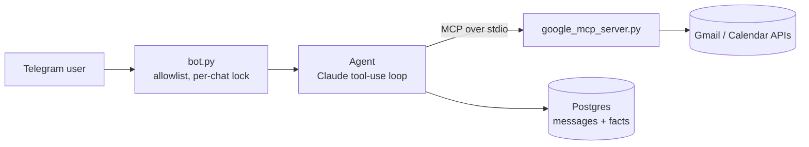

# Telegram MCP Agent

[](https://github.com/SidJanawade/telegram-mcp-agent/actions/workflows/ci.yml)

A personal assistant on Telegram that reads your Google Calendar and Gmail through a standalone
**MCP server**, creates calendar events, drafts emails for you to review, and keeps **persistent
memory in Postgres** across sessions.

## Architecture



| Module | Responsibility |
|---|---|
| `app/bot.py` | Telegram handlers, user allowlist, message chunking, graceful shutdown |
| `app/agent.py` | Tool-use loop, MCP client, system prompt, memory tools (`remember` / `forget`) |
| `app/google_mcp_server.py` | MCP server: calendar list/create, Gmail search/read/draft |
| `app/memory.py` | `Store` interface with Postgres (pooled) and in-memory implementations |
| `app/config.py` | Environment-based settings with startup validation |

## Design decisions

- **MCP instead of hardcoded tools.** Gmail and Calendar live in their own MCP server. The agent
  discovers tools at startup with `list_tools`, so the same server also works in Claude Desktop or
  any MCP client, and adding a tool needs no agent changes.
- **Two memory layers.** `messages` is short-term context (last N turns). `facts` is long-term:
  the model decides what to save via `remember` / `forget`, and saved facts are injected into every
  system prompt. Facts are capped in count and size, and `/memory` shows what is stored.
- **Allowlist first.** Every handler checks the Telegram user ID, and the bot refuses to start
  without `ALLOWED_USER_IDS`.
- **Least capability.** No tool sends or deletes email. Drafts only, for the user to review and
  send. Google has no draft-only OAuth scope, so `gmail.compose` is the narrowest that works and
  technically also allows sending: the guarantee comes from the tool surface, not the scope.
- **Prompt-injection posture.** Email and event content is declared untrusted in the system
  prompt, tool output is length-capped, and tool errors go back to the model instead of crashing.
  This reduces the risk but does not eliminate it, which is why sending is not exposed.
- **Non-blocking.** Database calls run in worker threads (`asyncio.to_thread`) over a connection
  pool, and chats are serialised individually so one slow chat never stalls another.

## Setup

1. Create a bot with [@BotFather](https://t.me/BotFather) and copy the token. Get your numeric
   user ID from [@userinfobot](https://t.me/userinfobot).
2. In Google Cloud, enable the Gmail and Calendar APIs and create an OAuth client of type
   *Desktop app*. Save it as `secrets/client_secret.json`.
3. On your own machine, run `python -m app.google_auth` once. It opens a browser and writes
   `secrets/token.json`.
4. `cp .env.example .env` and fill in `ANTHROPIC_API_KEY`, `TELEGRAM_BOT_TOKEN` and
   `ALLOWED_USER_IDS`.
5. `docker compose up --build`

To run without Docker: `pip install -r requirements.txt`, leave `DATABASE_URL` empty (in-memory,
not persistent), then `python -m app.bot`.

## Development

```bash
pip install -r requirements-dev.txt
ruff check . && ruff format --check .
pytest
```

Tests drive the agent loop with a scripted fake model, so they need no API keys or network. They
cover tool round-trips, memory persistence and limits, history-window handling, error paths and
the loop cap.

### Code review

Pull requests are reviewed automatically by [CodeRabbit](https://coderabbit.ai) using
`.coderabbit.yaml`, which carries path-specific instructions (for example, flag any MCP tool that
sends email or widens OAuth scopes). CI runs ruff, the tests and a Docker build on every push.

## Known limitations

- Single-user by design. Multi-user would need per-user Google tokens.
- Facts are retrieved by injecting all of them. Past a few hundred, switch to pgvector search.
- The Postgres store has no integration test in CI yet.

## License

MIT
